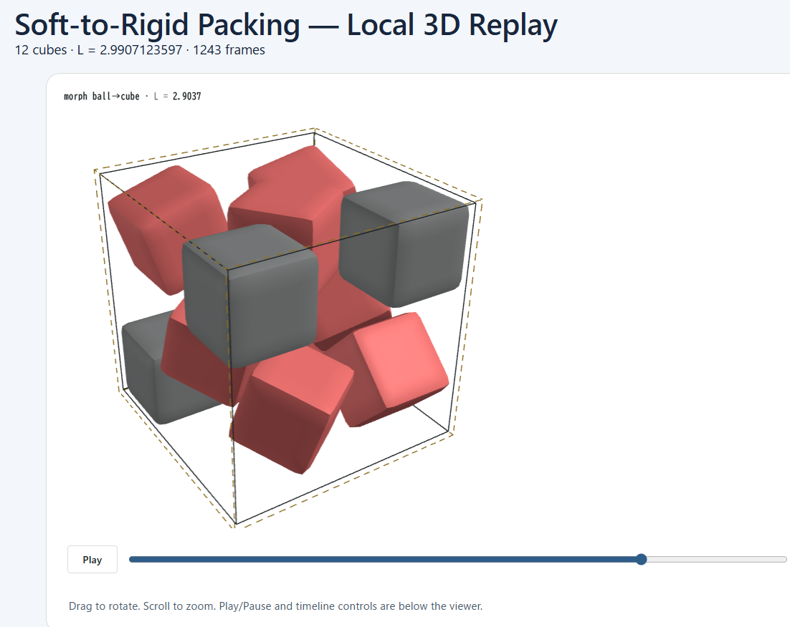

# Soft-to-Rigid Packing — Local 3D Replay Launcher

Run cube-packing experiments and watch the results in your browser, with a single Python command.

This is an **unofficial companion launcher** for [Yohei Nakajima's Soft-to-Rigid Packing](https://github.com/yoheinakajima/soft-to-rigid-packing). The original project provides the packing algorithm and 3D viewer; this script automates the local workflow for experimenting with different numbers of cubes and random seeds.

## Features

- **Configurable cube count:** Experiment with 1–200 unit cubes (larger experiments may be slow or fail to find good packings).
- **Reproducible runs:** Set a random seed.
- **Adjustable simulation:** Control the compression, sphere-to-cube morphing, and settling steps.
- **Automatic replay recording:** Save frames throughout the simulation.
- **Local 3D viewer:** Automatically start an HTTP server and open the replay in your browser.
- **Safe cleanup:** Reset only files generated by this launcher, leaving the original project's files untouched.
- **No extra Python packages:** Uses the Python standard library. Node.js and the original repository are required.

## Requirements

- Python 3.10 or newer
- Node.js installed and available on `PATH`
- The original [soft-to-rigid-packing](https://github.com/yoheinakajima/soft-to-rigid-packing) repository
- An internet connection to load the viewer's Three.js libraries from CDNs
- A modern browser with WebGL support

Tested workflow: Windows with Git Bash. The script uses cross-platform Python APIs, but other platforms are not guaranteed to be tested.

## Installation

1. Download or clone the original repository:

   ```bash
   git clone https://github.com/yoheinakajima/soft-to-rigid-packing.git
   cd soft-to-rigid-packing
   ```

   Alternatively, download its ZIP file from GitHub and extract it.

2. Copy **`packing_launcher.py`** into the repository root, next to the `src/` and `docs/` directories.

3. Check your installations:

   ```bash
   python --version
   node --version
   ```

No `pip install` is required for the launcher itself.

## Quick start

From the original repository's root directory:

```bash
python packing_launcher.py --n 8 --seed 17
```

The launcher will:

1. Clean up its previously generated files (unless `--no-clean` is specified).
2. Run the 3D cube-packing simulation using the original project's `src/cubes/sim3.js`.
3. Save replay frames to JSON.
4. Generate a local replay page.
5. Start a server and open the viewer in your default browser.

The default viewer URL is:

```text
http://127.0.0.1:8000/packing_launcher.html
```

If port 8000 is already in use, the launcher chooses an available port and prints the actual URL.

**Press `Ctrl+C` in the terminal to stop the server.** To run another experiment, stop the current launcher and execute it again with new arguments.

## Examples

### Experiment with 12 cubes

```bash
python packing_launcher.py --n 12 --seed 52
```

### Experiment with 26 cubes

```bash
python packing_launcher.py --n 26 --seed 17
```

### Spend more steps on optimization

```bash
python packing_launcher.py --n 12 --seed 52 --compact 10000 --morph 100000 --settle 6000
```

### Record more animation frames

```bash
python packing_launcher.py --n 8 --seed 17 --rec-every 20
```

Lower `--rec-every` values produce more frames and potentially larger JSON files.

### Run without opening the browser automatically

```bash
python packing_launcher.py --n 8 --no-browser
```

## Command-line options

| Option | Default | Description |
| --- | ---: | --- |
| `--n` | `8` | Number of unit cubes (1–200) |
| `--seed` | `17` | Random seed (0–4294967295) |
| `--compact` | `5000` | Initial compression steps |
| `--morph` | `45000` | Sphere-to-cube morphing steps |
| `--settle` | `3000` | Final settling steps |
| `--rec-every` | `100` | Record a frame every N steps |
| `--port` | `8000` | Preferred localhost port; automatically falls back if unavailable |
| `--no-browser` | Off | Do not open a browser automatically |
| `--no-clean` | Off | Keep old launcher-generated files until overwritten |
| `--random-seed` | Off | Generate a fresh random 32-bit seed; overrides `--seed` |

Run `python packing_launcher.py --help` for the built-in help.

## Generated files

The launcher creates or overwrites these files **inside the original repository**:

```text
soft-to-rigid-packing/
├── packing_launcher.py
├── .packing_launcher/
│   └── run.js
└── docs/
    ├── packing_launcher.html
    └── data/
        └── packing_launcher_replay.json
```

By default, only launcher-owned generated files are cleared before each run. **The original source code and official replay datasets are not deleted.** The replay JSON is replaced on subsequent runs, so back up any results you want to preserve.

## Understanding the results

The viewer shows the changing geometry and placement of cubes, along with the reported enclosing-box side length `L`. Smaller `L` means a smaller cubic container for the same number of unit cubes.

**Important:** The reported `certified side` is output from the original simulation code. This launcher does not perform an additional independent geometric proof, and a numerical packing result does not prove global optimality. Different seeds and step counts can lead to different local solutions.

For example, eight unit cubes can be packed into a `2 × 2 × 2` container, so `L = 2` is optimal for eight cubes. Larger or less structured cases can be much harder to optimize.

## Troubleshooting

**`ERROR: Put packing_launcher.py in the root...`**  
Make sure the script is alongside `src/` and `docs/` in the original repository, not inside either directory.

**`Node.js is missing from PATH`**  
Install Node.js, then restart the terminal.

**The page opens but the 3D viewer does not load**  
Check your internet connection and browser console. The page loads Three.js and OrbitControls from external CDNs.

**The simulation takes a long time or finds a loose packing**  
Try another `--seed` or increase `--compact`, `--morph`, and `--settle`. More steps do not guarantee a better solution.

**The replay JSON is very large**  
Increase `--rec-every` to record fewer frames.

## Credits

### Original Project

**Soft-to-Rigid Packing** was developed by [Yohei Nakajima](https://github.com/yoheinakajima).

Original repository: https://github.com/yoheinakajima/soft-to-rigid-packing

This launcher is an independent utility built to simplify running and visualizing experiments with the original project.

### AI-Generated Code and Documentation

**Both `packing_launcher.py` and this `README.md` were generated by OpenAI's ChatGPT under the direction of the repository maintainer.**

The launcher was developed to automate simulation execution, replay data generation, local server startup, and browser-based 3D visualization.

The repository maintainer provided the requirements, tested the tool, and guided its development.

This project is not officially affiliated with or endorsed by the original Soft-to-Rigid Packing project or OpenAI.

## License

This launcher is released under the **MIT License**. See the [LICENSE](LICENSE) file for details.

This repository is an independent utility for [Soft-to-Rigid Packing](https://github.com/yoheinakajima/soft-to-rigid-packing), originally developed by Yohei Nakajima.

The original project and any third-party dependencies remain subject to their respective licenses.

The launcher code and README documentation were generated with OpenAI's ChatGPT under human direction.

## Preview


